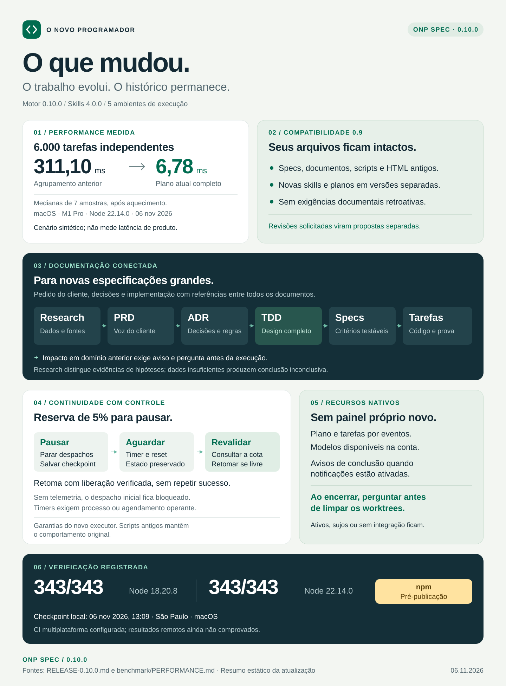

# ONP Spec

**Especificações verificáveis, do pedido à implementação.**

ONP Spec é o fluxo de desenvolvimento orientado a especificações do
**O Novo Programador**. Conecta o pedido do cliente às decisões, aos requisitos,
às tarefas e aos testes, mantendo essa relação verificável conforme o código
evolui. O test runner produz a evidência; o audit confere o alinhamento.



## O que o projeto oferece

- **Pesquisa de produto:** concorrentes, fontes, hipóteses e análise quantitativa
  para orientar decisões sem substituir a intenção do cliente.
- **Documentação conectada:** PRD, ADR, TDD, pesquisa, especificação e tarefas
  para novas features grandes.
- **Execução paralela:** tarefas independentes em worktrees, com estado
  persistido e retomada da execução.
- **Cinco harnesses:** integração com os recursos nativos disponíveis para
  planejamento, perguntas, agentes, timers e notificações.
- **Prova executável:** critérios de aceite vinculados a testes, auditoria de
  contratos e identificação de diferenças entre especificação e código.
- **Preservação do projeto:** atualizações não sobrescrevem documentos,
  customizações ou planos existentes.

## Começar

Requisitos: **Node.js ≥ 18** e Git para execuções com worktrees. O motor não
tem dependências de produção. Execução headless também exige o CLI do harness
disponível, autenticado e compatível com o sistema operacional usado.

Na raiz do projeto, consulte os identificadores disponíveis e escolha a integração.
Substitua `<harness>` pelo identificador exibido na ajuda:

```text
npx @onovoprogramador/onp-spec help
npx @onovoprogramador/onp-spec init --agents <harness>
```

O comando cria os arquivos ausentes e instala a skill com seu motor embarcado.
Depois da instalação, use o mecanismo de invocação do seu harness ou peça,
por exemplo: “especifique esta feature”, “execute as tarefas independentes”
ou “audite esta implementação”.

Para uma nova especificação grande:

```text
npx @onovoprogramador/onp-spec new minha-feature --grande --cliente "Pedido original do cliente"
npx @onovoprogramador/onp-spec plano minha-feature --agents <harness>
```

Preencha os documentos, revise o impacto e confirme as escolhas ainda não
autorizadas antes de executar o plano. Ao verificar a implementação:

```text
npx @onovoprogramador/onp-spec verify minha-feature
npx @onovoprogramador/onp-spec audit --ci
```

Também é possível executar qualquer comando diretamente pelo motor instalado:

```text
node <dir-da-skill>/scripts/onp-spec.mjs <comando>
```

Consulte o [guia técnico de integrações](docs/GUIA-DE-INTEGRACOES.md) para
instalação por ambiente, uso global, configuração, modelos e recursos nativos.

## Documentação e decisões

O contrato documental completo se aplica às **novas especificações grandes**,
criadas com `--grande`. Seus arquivos ficam em `.spec/features/<feature>/`:

| Arquivo | Finalidade |
|---|---|
| `prd.md` | Pedido literal, problema, objetivos e restrições do cliente |
| `adr.md` | Decisões arquiteturais, alternativas e consequências |
| `design.md` | TDD: arquitetura, contratos, dados, segurança, performance, testes e implantação |
| `research.md` | Concorrentes, fontes, hipóteses, dados e recomendações |
| `spec.md` | Histórias e critérios de aceite observáveis |
| `tasks.md` | Tarefas, requisitos atendidos e arquivos envolvidos |

Esses documentos se vinculam entre si. Criar os arquivos não significa
aprovar seu conteúdo: templates precisam ser preenchidos e revisados.
Interferências em domínios anteriores ou conflitos com regras de PRD/ADR
exigem alerta e pergunta pelo recurso nativo do harness antes da ação afetada.
A revisão e a resposta do cliente ficam registradas.

A pesquisa distingue observação, hipótese e estimativa. Quando há dados,
explicita amostra, unidades, custos, benefícios e incerteza. Sem evidência
suficiente, registra uma conclusão inconclusiva e propõe coleta. Uma proposta
que altera o escopo depende da decisão do cliente.

## Atualizar sem perder trabalho

Specs, PRDs, ADRs, designs, pesquisas, constituição e configuração existentes
mantêm seu conteúdo e formato. A atualização não aplica exigências documentais
retroativas nem acrescenta links aos arquivos antigos. Eles continuam sendo
referências para avaliar o impacto de trabalho novo.

Uma skill instalada idêntica é reutilizada, inclusive com arquivos adicionais
do usuário. Se houver diferenças, a atualização cria uma versão paralela;
a instalação anterior e suas customizações permanecem intactas. Invoque
explicitamente a versão que deseja usar.

Planos e scripts anteriores também são preservados. Havendo artefatos de uma
execução anterior, o novo plano fica em
`.spec/features/<feature>/execucoes/<runId>/`. Uma revisão solicitada deve ser
preparada separadamente, com as diferenças apresentadas antes de substituir
qualquer contrato existente.

## Execução, limites e acompanhamento

O executor nativo usa Node.js, sem depender de Bash. Tarefas independentes
podem executar em worktrees; `--paralelizar T-001,T-003` seleciona tarefas e
`--sequencial` mantém a execução em ordem. Os modelos headless são consultados
no catálogo disponível do harness e da conta, sem presumir nomes fixos.

Com **5% ou menos de cota restante**, o executor suspende novos despachos,
preserva o estado e aguarda uma nova leitura que comprove a liberação. Usa o
horário de reset informado ou intervalos de espera progressivos. Um timer
vencido, sozinho, não comprova que a cota voltou.

Essa proteção depende de telemetria real e recente. Quando a integração não
expõe cota diretamente, é necessária uma ponte para a fonte nativa do
cliente ou provedor. Sem esse dado na consulta inicial, o executor bloqueia
o despacho com `QUOTA_UNAVAILABLE`. Após um limite confirmado, uma falha de
telemetria mantém a espera. Tokens de contexto não são tratados como créditos.

Para continuar durante a noite, o processo ou scheduler nativo precisa
permanecer operante. Desligar a máquina interrompe timers locais; o checkpoint
permite uma retomada posterior. As garantias novas de cota e checkpoint se
aplicam ao executor nativo desta versão, sem alterar scripts legados.

O acompanhamento usa o plano e a lista de tarefas do harness, **sem painel
próprio** nem chamadas extras de modelo para narrar o progresso. Notificações
de conclusão usam recursos nativos quando habilitados e disponíveis na
integração, respeitando as preferências existentes.

Ao fim da sessão, a skill pergunta se você quer limpar os worktrees usados.
A remoção depende de resposta afirmativa e preserva trabalho ativo,
alterações locais e commits ainda não integrados.

## Verificação e desenvolvimento

Cada critério de aceite se liga a um teste pelo marcador `@spec:AC-xxx`.
O teste precisa passar em `verify`; testes pulados ou marcados como pendentes
não contam como prova. `audit --ci` verifica rastreabilidade, constituição,
perguntas, suposições e alinhamento com o código. A revisão semântica dos
contratos complementa essa verificação mecânica.

Para desenvolver o motor e sincronizar as skills:

```text
node tools/build-skill.mjs
npm test
```

As [medições de performance](benchmark/PERFORMANCE.md) apresentam método,
dados e limitações. O [exemplo executável](examples/inscricao-turma) demonstra
o fluxo, e a [arquitetura](ARQUITETURA.md) descreve o motor.

## Licença

[MIT](LICENSE) © Vitor Manoel — O Novo Programador.
